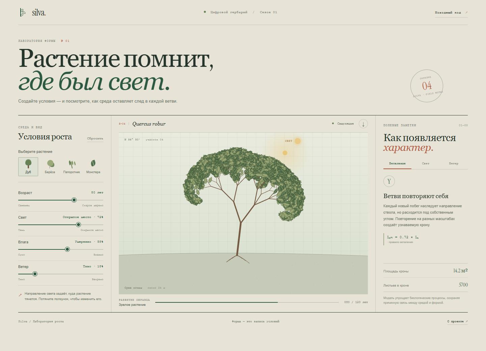

# Silva — Plant Growth Lab

**A digital field station for procedural growth.** Silva turns a small set of environmental conditions into a botanical study: choose a species, adjust its habitat, and observe how the plant bends, branches, and fills out over time.

## Русский

Silva — интерактивная лаборатория процедурного роста. Выберите дуб, берёзу, папоротник или монстеру и меняйте возраст, направление света, влагу и ветер. Иллюстрация пересчитывается сразу: меняются силуэт, плотность кроны, листья, наклон и расчётные параметры образца.

### Что внутри

- Повторяющиеся ветви формируют крону на нескольких масштабах.
- Фототропизм направляет рост к свету; сильное боковое освещение заметно изгибает растение.
- Механическая нагрузка ветра меняет наклон и асимметрию.
- Возраст управляет количеством уровней ветвления, а доступность воды — размером листьев.
- У видов отдельные формы роста и листьев; у монстеры показаны характерные прорези, у папоротника — дуговые вайи.
- Иллюстрацию можно сохранить в PNG. Всё работает локально в браузере без сервера и библиотек.

Модель художественно упрощает реальную ботанику: она показывает причинные связи между условиями и формой, но не предсказывает биологический рост конкретного растения.

### Запуск

Откройте `index.html` в браузере или запустите любой локальный статический сервер из этой папки.

## English

Silva is an interactive procedural growth lab. Choose an oak, birch, fern, or monstera, then change its age, light direction, water, and wind. The illustration updates immediately: silhouette, canopy density, leaves, lean, and specimen estimates all respond to the environment.

### What it demonstrates

- Recursive branching builds a canopy across several scales.
- Phototropism turns new growth toward the light; strong side lighting visibly bends the plant.
- Wind load changes lean and asymmetry.
- Age controls branching depth, while water availability changes leaf size.
- Each species has its own growth pattern and foliage; monstera leaves include characteristic splits and the fern grows arching fronds.
- Save the illustration as a PNG. The app runs locally in the browser without a server or dependencies.

The model is an artistic simplification of botany. It demonstrates cause and effect between conditions and form; it does not predict the biological growth of a specific plant.

### Run

Open `index.html` in a browser or serve this directory with any local static web server.

## Design idea

The interface borrows from a field notebook and botanical plate: the drawing is the specimen under observation, the sliders describe its habitat, and the notes explain the process that shaped it. Muted paper, ink-green linework, and clay-red marks give the simulator a studied, tactile character while keeping the living form prominent.
